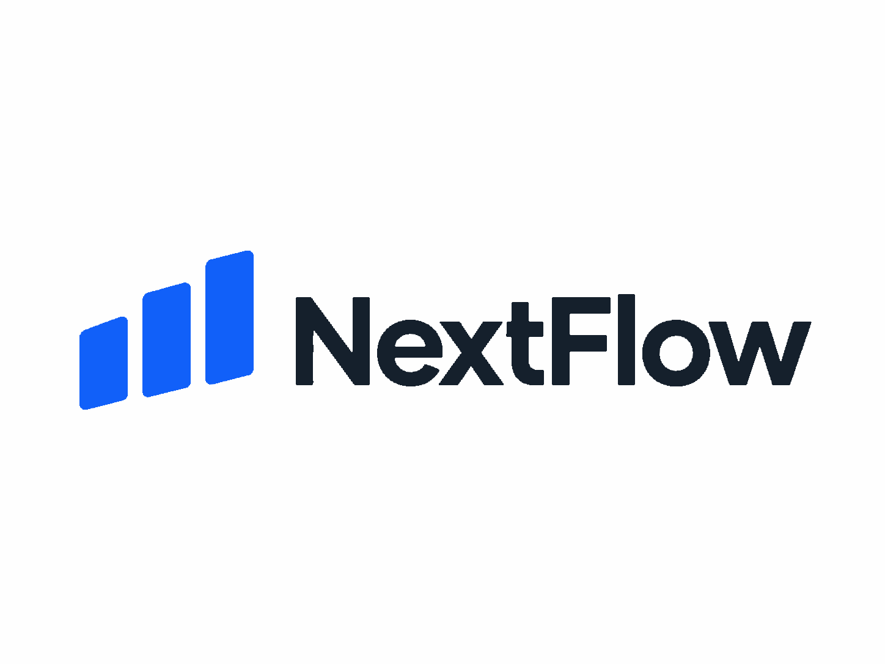
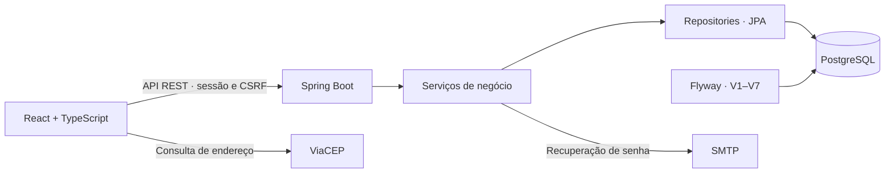

<div align="center">

<h1>
  <picture>
    <source media="(prefers-color-scheme: dark)" srcset="image/nextFlowDark.svg" />
    <source media="(prefers-color-scheme: light)" srcset="image/nextFlow.svg" />
    
  </picture>
</h1>

<p><strong>Gestão operacional e financeira em um só lugar.</strong></p>

<p>Clientes, entregas, recebimentos e gastos conectados à rotina do seu negócio.</p>

<p>
  
  
  
  
</p>

<p>
  <a href="#visão-geral-da-plataforma">Plataforma</a> ·
  <a href="#principais-funcionalidades">Funcionalidades</a> ·
  <a href="#stack-tecnológica">Tecnologias</a> ·
  <a href="#instalação-e-execução">Instalação</a> ·
  <a href="#documentação-técnica-e-api">Documentação</a>
</p>

<sub>Em desenvolvimento · Primeiro fluxo: entregas de água · Evolução planejada por segmento</sub>

</div>

---

## Visão geral da plataforma

A operação começa na empresa selecionada e acompanha o serviço até o recebimento. A interface reúne as áreas de trabalho em uma navegação única, com temas claro e escuro.

| Organize | Acompanhe | Consulte |
| --- | --- | --- |
| Empresas, contatos e clientes | Entregas, pagamentos e gastos do dia | Movimento diário, histórico e valores pendentes |

**Um fluxo, duas datas importantes.** Uma entrega realizada em 10/10 pode ser paga em 23/10. O histórico mantém a data da entrega; o dinheiro entra no movimento de 23/10. Assim, trabalho realizado e recebimentos permanecem distinguíveis.

## Sobre o NextFlow

O NextFlow é uma aplicação de gestão operacional e financeira para pequenos negócios, autônomos e prestadores de serviços. Seu objetivo é reunir o que foi realizado, o que já foi recebido e o que ainda falta receber, com dados separados por empresa.

O primeiro fluxo atende a entregas de água por caminhão-pipa. A direção do produto é um **SaaS adaptável ao segmento da empresa**, com uma base compartilhada de clientes e financeiro e recursos próprios para cada operação. A seleção de módulos por segmento, incluindo futuras atividades como barbearia, faz parte do roadmap.

A implementação atual combina uma API Java/Spring Boot, PostgreSQL e uma interface React. Autorização por empresa, precisão monetária e serviços de negócio independentes da interface orientam a evolução.

## Principais funcionalidades

### Gestão de clientes

Cadastro, consulta e edição de clientes por empresa, com nome, telefone e observação. Entregas também podem ser avulsas, com identificação opcional, sem obrigar o cadastro de um contato.

### Controle de entregas

Registro de data, litros inteiros positivos e valor total informado pelo usuário. O valor pode considerar descontos: não há cálculo automático de preço por litro. Entregas sem cobrança não geram dívida e admitem motivo opcional.

### Gestão financeira

Recebimentos integrais ou parciais, com data efetiva e histórico individual de pagamentos. O servidor rejeita valores acima do saldo pendente. Gastos são lançamentos separados, efetivamente pagos e sem recorrência automática.

O Movimento do dia reúne entregas, litros, recebimentos e gastos, com totais completos e listas paginadas. **Saldo do dia é recebido menos gastos daquela data; não representa lucro nem saldo acumulado.**

### Histórico e pendências

Consulta de entregas por período, situação de pagamento e detalhe dos recebimentos. Pagamentos posteriores reduzem a dívida preservando o histórico.

### Empresas e acesso

Uma conta pode administrar várias empresas. Cadastro e login por e-mail, logout e recuperação de senha via SMTP estão integrados à interface. Cada consulta ou alteração de dados de negócio verifica o vínculo com a empresa no servidor.

<details>
<summary><strong>Escopo atual e limites funcionais</strong></summary>

- Relatórios ainda exibem **Em desenvolvimento**.
- A atividade da empresa aceita `servicos`, `produtos` ou `ambos`; ainda não configura módulos por segmento.
- Existe somente o papel de proprietário. Funcionários, caminhões e equipes diárias ainda não estão implementados.
- Exclusão/arquivamento de empresas, edição/exclusão de entregas e gastos e estorno de pagamentos não estão disponíveis.
- Pendências começam no mês atual; amplie o período para consultar dívidas anteriores.
- Entrega e pagamento são operações separadas. Em falha de comunicação, confira os registros antes de repetir: ainda não há idempotência para reconhecer reenvios.
- O ícone da empresa fica na memória da página. CNPJ não faz parte do cadastro atual.
- WhatsApp, Telegram e cobrança de assinaturas do SaaS não estão implementados.

</details>

## Stack tecnológica

| Camada | Tecnologias |
| --- | --- |
| **API** | Java 21 · Spring Boot 4.1.1 · Web MVC · Security · Bean Validation |
| **Persistência** | PostgreSQL 16 · Spring Data JPA/Hibernate · Flyway |
| **Interface** | React 19.3.1 · TypeScript 5.9.3 · Vite 7.3.7 · CSS próprio |
| **Integrações** | Spring Mail/SMTP para recuperação de senha · ViaCEP para endereço |
| **Testes** | JUnit Jupiter · Mockito · AssertJ · MockMvc · Testcontainers · Node.js Test Runner |
| **Ferramentas** | Maven Wrapper · npm · PowerShell · Docker para PostgreSQL e integração |

Versões do frontend conferidas no [lockfile](frontend/package-lock.json); use `npm ci` para reproduzir a resolução. O [pom.xml](pom.xml) gerencia as dependências Java pelo Spring Boot. O Wrapper 3.3.4 está configurado para Maven 3.10.0; as migrações existentes vão de V1 a V7.

## Arquitetura do sistema

Backend organizado por domínio em um monólito, com frontend separado. Controllers definem o contrato HTTP; serviços concentram regras e autorização; repositories acessam os dados por JPA.



- **Isolamento:** consultas combinam identidade autenticada, empresa e registro solicitado.
- **Dinheiro:** `BigDecimal`, BRL e duas casas decimais, sem arredondamento automático.
- **Consistência:** saldo e pagamento são gravados na mesma transação; recebimentos usam bloqueio da entrega para controlar concorrência.
- **Esquema:** Flyway versiona as mudanças; Hibernate valida as tabelas.
- **Interface:** cookie de sessão HttpOnly e proteção CSRF; o proxy Vite encaminha `/api` ao backend no desenvolvimento.

A validação integrada das consultas e do controle concorrente com PostgreSQL permanece pendente. O acompanhamento técnico está em [estado atual](docs/estado-atual.md).

<details>
<summary><strong>Organização do projeto</strong></summary>

```text
NextFlow/
├── src/main/java/com/nextflow/
│   ├── autenticacao/         # Sessão e recuperação de senha
│   ├── usuario/              # Identidade de acesso
│   ├── estabelecimento/      # Empresas e vínculos
│   ├── cliente/              # Clientes por empresa
│   ├── entrega/              # Entregas e pagamentos
│   ├── gasto/                # Saídas efetivas de caixa
│   ├── movimento/            # Totais e recebimentos por data
│   └── compartilhado/erro/   # Respostas de erro
├── src/main/resources/
│   ├── db/migration/         # Migrações Flyway
│   └── templates/email/      # Recuperação de senha
├── src/test/java/            # Testes rápidos e integração
├── frontend/
│   ├── src/api/              # Clientes HTTP
│   ├── src/                  # Telas, componentes e estilos
│   └── tests/                # Testes Node.js
├── docs/                     # Contratos e decisões técnicas
├── .env.example              # Exemplo sem senhas
├── iniciar-dev.ps1           # Inicialização local da API
└── pom.xml
```

`frontend/src/Historico.tsx` e `frontend/src/demo/` são referências legadas desconectadas do Workspace. Seus testes não comprovam o domínio financeiro atual.

</details>

## Instalação e execução

### Pré-requisitos

JDK **21**, Node.js **24+** com npm e PostgreSQL **16**, com banco e usuário previamente criados. Maven é obtido pelo Wrapper. Git é necessário para clonagem; Docker é necessário para os testes Testcontainers e opcional para hospedar o banco local.

O fluxo abaixo usa PowerShell. Execute a API diretamente no JDK/IDE e mantenha o PostgreSQL separado.

### 1. Obtenha o projeto

Use a URL real do repositório em uma pasta de trabalho:

```powershell
$urlRepositorio = Read-Host 'URL do repositório NextFlow'
git clone $urlRepositorio NextFlow
Set-Location NextFlow
```

Se já possui a cópia local, abra sua raiz. No ambiente de desenvolvimento atual:

```powershell
Set-Location C:\NextFlow
```

### 2. Prepare o banco e o ambiente

Em uma instalação nova, provisione PostgreSQL 16, crie um banco vazio chamado `nextflow` e um usuário com permissão para aplicar migrações. O repositório não fornece Docker Compose ou provisionamento automático. Em um ambiente existente, preserve o banco e informe seu nome real em `DB_NAME`.

Crie o arquivo local sem sobrescrever configurações existentes:

```powershell
if (-not (Test-Path -LiteralPath .env)) {
    Copy-Item -LiteralPath .env.example -Destination .env
}
```

Preencha `DB_USERNAME` e `DB_PASSWORD` no `.env`. Revise host, porta e nome do banco e configure SMTP: o exemplo usa Gmail autenticado e exige usuário, credencial e remetente. Para SMTP local de desenvolvimento, consulte [autenticação e e-mail](docs/autenticacao.md).

<details>
<summary><strong>Conexão, variáveis de ambiente e banco existente</strong></summary>

| Variáveis | Configuração |
| --- | --- |
| `DB_HOST`, `DB_PORT`, `DB_NAME` | Padrões: `localhost`, `5432`, `nextflow` |
| `DB_USERNAME`, `DB_PASSWORD` | Obrigatórias; use as credenciais do banco provisionado |
| `SMTP_HOST`, `SMTP_PORT` | Backend: `localhost:1025`; exemplo: `smtp.gmail.com:587` |
| `SMTP_USERNAME`, `SMTP_PASSWORD`, `SMTP_FROM` | Usuário, credencial e remetente do provedor |
| `SMTP_AUTH`, `SMTP_STARTTLS` | Backend: `false`; exemplo Gmail: `true` |
| `SESSION_COOKIE_SECURE` | `false` no HTTP local; produção requer HTTPS e `true` |

Sem configuração de remetente, o backend usa `nao-responda@nextflow.test`. Para Mailpit, use `localhost:1025`, autenticação/STARTTLS desabilitados e um remetente de teste; é necessário um receptor SMTP para visualizar as mensagens.

Se o PostgreSQL usa um container existente, confira seu nome e estado antes de iniciá-lo:

```powershell
docker ps -a --format 'table {{.Names}}\t{{.Status}}\t{{.Ports}}'
$nomeContainer = Read-Host 'Nome do container PostgreSQL existente'
docker start $nomeContainer
```

O banco precisa estar acessível na porta configurada. Não recrie containers/volumes para aplicar migrações e não altere `DB_NAME` de um ambiente existente sem uma mudança coordenada no PostgreSQL.

Flyway aplica migrações pendentes na inicialização. Hibernate usa `ddl-auto=validate`; baseline automático e limpeza Flyway estão desabilitados. Esquemas existentes sem histórico Flyway exigem avaliação antes da inicialização.

As configurações estão em [.env.example](.env.example), [application.properties](src/main/resources/application.properties) e [vite.config.ts](frontend/vite.config.ts). Nunca versione o `.env` nem coloque segredos em variáveis `VITE_*`.

</details>

### 3. Inicie a API

Na raiz do projeto:

```powershell
.\iniciar-dev.ps1
```

O script carrega o `.env` e executa o Maven Wrapper. Variáveis não vazias já definidas no processo têm prioridade. Os valores são literais, sem execução/expansão de comandos; use uma entrada `NOME=valor` por linha e comentários somente em linhas próprias.

O Spring Boot não lê `.env` automaticamente. Na IDE, configure as variáveis na execução. Em Linux/macOS, exporte-as no shell e execute `sh ./mvnw spring-boot:run`.

### 4. Inicie a interface

Em outro terminal, na raiz:

```powershell
npm ci --prefix frontend
npm run dev --prefix frontend
```

**Interface:** http://localhost:5173 · **API:** http://localhost:8080 · **PostgreSQL padrão:** `localhost:5432`

Use `localhost` consistentemente para preservar o contexto dos cookies. Crie sua conta pela interface e cadastre ou selecione uma empresa em **Minha empresa**. Não há usuário ou senha padrão.

## Documentação técnica e API

| Guia | Conteúdo |
| --- | --- |
| [Interface](frontend/README.md) | Telas, navegação, execução e comportamento dos formulários |
| [Autenticação](docs/autenticacao.md) | Sessão, CSRF, recuperação de senha e configuração SMTP |
| [Empresas](docs/empresa-integracao.md) | Cadastro, edição e contrato dos dados da empresa |
| [Isolamento](docs/estabelecimentos.md) | Vínculos e acesso por empresa |
| [Clientes](docs/clientes.md) | Campos, paginação e edição |
| [Gastos](docs/gastos.md) | Lançamentos e totais por data |
| [Entregas e movimento](docs/entregas.md) | Pagamentos, saldo pendente e resumo diário |
| [Estado atual](docs/estado-atual.md) | Histórico de decisões, validações e pendências técnicas |

### Contratos principais

As rotas de negócio são delimitadas por empresa:

```text
/api/auth
/api/estabelecimentos
/api/estabelecimentos/{empresaId}/clientes
/api/estabelecimentos/{empresaId}/entregas
/api/estabelecimentos/{empresaId}/entregas/{id}/pagamentos
/api/estabelecimentos/{empresaId}/gastos
/api/estabelecimentos/{empresaId}/movimento
```

Obtenha CSRF em `GET /api/auth/csrf`, preserve a sessão e use o header informado na resposta nas escritas, inclusive cadastro, login e recuperação. Login recebe formulário com `email` e `password`; cadastro recebe JSON com `nome`, `email` e `senha`. Após login/logout, obtenha novo CSRF.

Leituras exigem vínculo com a empresa; escritas exigem proprietário. Registros alheios retornam `404`; validação, `400`; sessão ausente, `401`; CSRF inválido, `403`. Listagens de negócio usam páginas a partir de zero, com tamanho de 1 a 100.

<details>
<summary><strong>Exemplo de requisição e resposta: entrega avulsa</strong></summary>

Exemplo do contrato implementado. Substitua empresa, sessão e token pelos valores do seu ambiente; o UUID retornado abaixo é ilustrativo.

```http
POST /api/estabelecimentos/{empresaId}/entregas HTTP/1.1
Host: localhost:8080
Content-Type: application/json
Cookie: JSESSIONID=<sessao>
X-CSRF-TOKEN: <token-obtido-em-api-auth-csrf>

{
  "data": "2026-10-10",
  "clienteId": null,
  "identificacaoAvulso": "Cliente avulso de exemplo",
  "litros": 1000,
  "valorTotal": "150.00",
  "semCobranca": false,
  "motivo": null
}
```

Resposta `201 Created`:

```json
{
  "id": "f1806cee-479d-42b5-9164-62fa3bb4c2f0",
  "clienteId": null,
  "identificacao": "Cliente avulso de exemplo",
  "data": "2026-10-10",
  "litros": 1000,
  "valorTotal": 150.00,
  "valorPago": 0.00,
  "saldoPendente": 150.00,
  "semCobranca": false,
  "motivo": null
}
```

Para receber, use `POST /api/estabelecimentos/{empresaId}/entregas/{id}/pagamentos` com `data` efetiva e `valor` positivo até o saldo. Datas futuras são rejeitadas.

Histórico recebe `inicio`, `fim`, `pendentes`, `pagina` e `tamanho`. Gastos e movimento recebem `data`, `pagina` e `tamanho`; movimento pagina recebimentos e retorna totais completos da data.

</details>

A documentação da API está nos contratos acima; não há Swagger/OpenAPI configurado. A preparação para produção inclui HTTPS, cookies seguros e roteamento da interface/API na mesma origem.

## Testes e qualidade

Na raiz do projeto:

```powershell
# Testes rápidos do backend, sem Docker
.\mvnw.cmd test

# Testes rápidos e integração com PostgreSQL temporário
.\mvnw.cmd verify

# Validações e testes HTTP/renderização estática do frontend
npm test --prefix frontend

# TypeScript e build de produção
npm run build --prefix frontend
```

A suíte cobre regras monetárias, entradas, autorização por empresa, sessão/CSRF e recuperação de senha. Testes de integração incluem persistência, migrações e concorrência. Surefire executa testes rápidos; Failsafe executa `*IT` com PostgreSQL 16 temporário via Testcontainers, sem usar o banco da aplicação. E-mail é substituído por mocks/fakes.

Os testes frontend usam fetch simulado, servidor HTTP local de teste e renderização estática. Eles não substituem a validação do fluxo autenticado no navegador. Resultados executados e verificações pendentes estão em [estado atual](docs/estado-atual.md); relatórios Java são gerados em `target/surefire-reports/` e `target/failsafe-reports/`.

## Roadmap

### Evolução do produto

- [ ] Seleção de segmento com campos e fluxos próprios por atividade.
- [ ] Cadastro operacional de funcionários, sem login nesta primeira etapa.
- [ ] Caminhões e uma equipe por veículo/dia, com motorista e ajudante opcional.
- [ ] Entregas e gastos vinculados ao caminhão, mantendo registros sem veículo e gastos gerais.
- [ ] Produção, recebimentos, gastos e pendências por caminhão, com equipe histórica preservada.
- [ ] Relatórios e futura integração WhatsApp pelos serviços de negócio.

### Engenharia e regras a definir

- [ ] Concluir a validação integrada e do fluxo completo no navegador.
- [ ] Idempotência para evitar duplicidade em reenvios.
- [ ] Melhorar a consulta inicial de dívidas antigas.
- [ ] Definir arquivamento/exclusão de empresas e correções/estornos com preservação do histórico.
- [ ] Preparar implantação e recuperação operacional de e-mails para uso público.

Pagamentos tardios deverão permanecer ligados à entrega/caminhão de origem, sem confundir esse vínculo com quem recebeu o dinheiro. Barbearia, troca de segmento com dados existentes, permissões com login e cobrança de assinaturas ainda precisam de definição.

## Contribuição e licença

Mudanças devem ser pequenas e revisáveis, com testes proporcionais ao risco. Use dados fictícios em exemplos e reproduções; nunca envie credenciais, `.env`, backups ou dados financeiros reais.

Issues devem descrever problema, resultado esperado e passos de reprodução. Pull requests devem explicar o comportamento alterado, as verificações executadas e suas limitações. Antes de contribuir, leia [AGENTS.md](AGENTS.md) e os contratos do módulo. A política de contribuições externas ainda não foi definida.

**Licença:** o repositório ainda não possui arquivo de licença nem licença definida no `pom.xml`. As condições de uso e distribuição precisam ser formalizadas pelo mantenedor.

